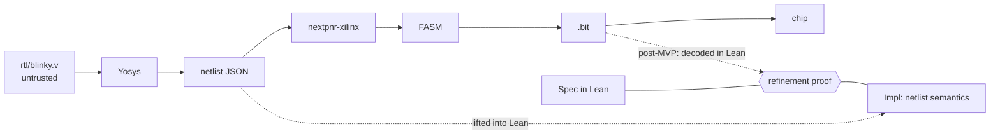

# Verified Blinky: a formally verified LED on a Spartan-7

## What this project is

The smallest possible end-to-end slice of a larger goal: hardware whose
behaviour is proved in the Lean 4 theorem prover, with the proof reaching as
close to the physical configuration bits as open documentation allows.

The MVP: blink an LED on an Astria board (AMD/Xilinx Spartan-7 XC7S50), then
prove in Lean that the circuit the tools produced implements a blinking LED.

The long-term goal (NOT this MVP): a hardware description language embedded in
Lean, with a checker that decodes the final bitstream and proves it equivalent
to the Lean source. Every decision here should keep that path open, but do not
build any of it early.

## Primer: what changed in FPGAs since the mid 90s

- **Logic cell.** 7-series uses 6-input LUTs (64-bit truth table, the `INIT`
  parameter). LUTs and flip-flops are grouped into *slices*, slices into CLB
  tiles. Each slice has a hard carry chain (`CARRY4`, 4 bits per slice) that
  synthesis uses for adders and counters.
- **Flip-flops have a configured power-up value** (`INIT`), loaded with the
  bitstream. A design needs no reset signal to start in a known state.
- **Clocks** travel on dedicated low-skew networks entered through a `BUFG`
  buffer. Never route a clock through ordinary logic.
- **The device is a grid of tiles** joined by programmable interconnect points
  (PIPs). A bitstream is a set of *frames*; each bit either sets a LUT/FF/IO
  option or turns on a PIP.
- **The flow** is: HDL → *synthesis* (to a netlist of vendor primitives) →
  *pack/place/route* → *bitstream generation* → JTAG load.
- **There is now an open toolchain for this chip**, which is why this project
  is possible:
  - **Yosys**: synthesis. `synth_xilinx` outputs a netlist of Xilinx
    primitives (`LUT1`..`LUT6`, `FDRE`, `CARRY4`, `IBUF`, `OBUF`, `BUFG`).
  - **nextpnr-xilinx**: place and route.
  - **Project X-Ray (prjxray)**: a database, reverse engineered by fuzzing the
    vendor tool, documenting what each bitstream bit means.
  - **FASM**: a text format listing enabled features, one per line. It sits
    between routing and the binary frames.
  - **openXC7**: the project that packages all of the above for 7-series.
  - **Chip database (chipdb)**: a per-part, per-package binary file nextpnr
    needs. Prebuilt ones exist for common packages; others are generated from
    the X-Ray database.
  - **openFPGALoader**: loads a `.bit` over JTAG.
- The vendor tool (Vivado) is not used in the MVP. It is a possible second
  oracle later.

## Primer: Lean 4, the parts this project uses

- Lean 4 is a functional programming language and a proof assistant in one.
  Programs and proofs live in the same files. A small trusted *kernel* checks
  every proof; tactics are untrusted programs that build proof terms.
- Tooling: `elan` (toolchain manager), `lake` (build tool), a `lean-toolchain`
  file pins the version. Pin the latest stable release; look it up, do not
  assume a version from memory.
- `BitVec n` is a fixed-width bitvector type in the core library, with
  arithmetic, shifts, bit extraction, `msb`.
- `bv_decide` is a tactic that proves closed statements about `BitVec` and
  `Bool` by translating to SAT, running a solver, and checking the solver's
  certificate. It is the workhorse for circuit equivalence here.
- `sorry` is a placeholder that makes any goal "pass". `axiom` adds an
  unproved assumption. `#print axioms thm` lists everything a theorem
  ultimately rests on. This command is how we audit trust.
- Do not add Mathlib unless a proof truly needs it; it adds long builds. Core
  Lean plus `Std` should be enough for the MVP.

Lean and its libraries move fast. Your memory of lemma names, import paths and
tactic syntax is likely to be out of date. Before relying on a name, confirm
it exists in the pinned toolchain (`#check`, `exact?`, grep the toolchain
sources). Build after every small change with `lake build`.

## The verification idea

Nothing in the build toolchain is trusted. The tools are *oracles*: they
produce an artifact, and Lean checks the artifact against a specification.
A buggy tool produces a failed proof, never a false theorem.



Three Lean objects:

1. **Spec**: what "blinks" means, as mathematics. No hardware detail.
2. **Impl**: the netlist the tools produced, read into Lean as data, with a
   meaning given by Lean definitions of each primitive.
3. **Refinement theorem**: for every clock cycle, Impl's LED output equals the
   Spec's.

The hand-written Verilog is just a convenient way to get a netlist. It is not
trusted and not part of any theorem.

## Board facts: confirm before anything else

These are unverified. Do not invent values. Ask Kirill, or read them from the
board vendor's schematic, XDC file or Vivado board files, and record the
source next to each value in `board/FACTS.md`.

| Fact | Value | Source |
|---|---|---|
| Board | Adiuvo Engineering Astria S7-50 (earlier name: Leonidas). FPGA plus an RP2040, 4 user LEDs, 4 slide switches, SDRAM, Pmods | vendor product page |
| FPGA part | XC7S50, confirmed by JTAG IDCODE 0x362f093 | vendor product page; `openFPGALoader -c ft232 --detect` |
| Package | FTGB196 | Kirill |
| Speed grade | Assume -1 (slowest, conservative). Not readable from the chip marking. Affects timing analysis only, not the bitstream. Use part name `xc7s50ftgb196-1`; correct it if the vendor board files say otherwise | assumption |
| Chip marking | XC7S50 / FTGB196ABX2533 / D4BDT096A | photo from Kirill |
| Clock source, pin and frequency | Own oscillator U10 (KC2520Z100), 100 MHz, into G11 (`IO_L12P_T1_MRCC_14`) via 33 ohm, LVCMOS33. Not from the RP2040 | KiCad netlist, vendor XDC and board.xml; see `board/FACTS.md` |
| User LED pin, IO standard, polarity | LED0..3 = E11, M10, A10, D12; LVCMOS33; active high (pin -> 110 ohm -> LED -> GND). Blinky uses LED0 / E11 | KiCad netlist, vendor XDC |
| JTAG interface and openFPGALoader cable name | FTDI FT232HL, ADBUS0..3 = TCK/TDI/TDO/TMS, USB connector J1. Cable `ft232` (`openFPGALoader -c ft232`), confirmed; IDCODE 0x362f093 = xc7s50 | KiCad netlist |
| Bank voltage for the LED and clock pins | Bank 14 VCCO = 3.3 V (banks 0 and 34 also 3.3 V) | KiCad netlist |
| Vendor files target XC7S6, not XC7S50 | Same FTGB196 footprint ("compatible up to XC7S50"). All 100 IO pins checked against X-Ray `xc7s50ftgb196-1/package_pins.csv`: identical | user guide p.12; `board/FACTS.md` |

Sources to read, in this order. Kirill has the schematic; ask him to put it
in `board/`. The vendor's reference designs, XDC, schematics and Vivado board
definition are in a public repository:
`https://bitbucket.org/adiuvo-engineering/leonidas_embedded_development`.
Clone it outside this repo and take the package, pins and IO standards from
its XDC and board files. Where the XDC and the schematic disagree, stop and
ask.

Three things to watch:

- **Package.** FTGB196 is not the CSGA324 that prebuilt chip databases
  cover, so generating a chipdb for `xc7s50ftgb196` is part of M0. The X-Ray
  database does contain `spartan7/xc7s50ftgb196-*` directories (pin map and
  part files); confirm they are present in the installed copy. The die is the
  same as in other packages, so only pin mapping differs, not the bitstream
  format.
- **The RP2040 shares the board.** It may drive FPGA pins, the clock, or the
  configuration lines depending on its firmware. Find out what its stock
  firmware does before driving any shared pin from the FPGA.
- **Vendor examples are Vivado projects.** Use them as a source of pin data
  only. This project does not use Vivado.

## Milestones

Work strictly in order. Each milestone ends with its acceptance check passing
and a `jj` commit. Stop and report at the end of each one.

### M0: environment and facts

- Install, without Nix and without root: yosys, nextpnr-xilinx, the prjxray
  database and tools, `fasm2frames`, `xc7frames2bit`, openFPGALoader.
  First choice: the prebuilt bundle from `FPGAwars/tools-openxc7`
  (`install.sh` fetches oss-cad-suite plus an openXC7 package). Fallbacks:
  the openXC7 `toolchain-installer` script or the openXC7 snap. Read the
  current README of whichever you use; do not rely on remembered commands.
- Install Lean with `elan` (user-level installer), create the `lake` project,
  pin the toolchain in `lean-toolchain`.
- `.envrc` at the repo root (loaded by direnv, which Kirill uses) that puts
  the tools on `PATH` and exports the chipdb and X-Ray database locations.
  It must stay plain `export` lines so it also works as `. ./.envrc` in
  bash; in this agent's shell, which has no direnv, load it that way.
  `TOOLS.md` recording the exact version or release of every tool, since
  nothing else pins them.
- Fill in `board/FACTS.md`.
- Chip database: generate one for `xc7s50ftgb196` from the X-Ray database
  with nextpnr-xilinx's own export scripts (the openXC7 demo projects and
  `tools-openxc7` both show the steps). If the prebuilt bundle lacks those
  scripts, build nextpnr-xilinx from source instead. This can take a long
  time and a lot of memory; say so before starting, and keep the result
  outside `build/` so it is generated once.
- **Accept:** `openFPGALoader --detect` reports an XC7S50; a chipdb for the
  confirmed part and package loads in nextpnr-xilinx; `lake build` succeeds
  on an empty Lean project; `TOOLS.md` and `board/FACTS.md` are complete.

### M1: blink it, unverified

- `rtl/blinky.v`: a free-running N-bit counter with a power-up value of zero,
  no reset input, LED driven by the top bit. Choose N so the LED period is
  about one second at the confirmed clock frequency (N = 27 at 100 MHz gives
  1.34 s).
- `board/astria.xdc`: pin and IO standard constraints from `FACTS.md`.
- Build script (Makefile or justfile):
  `yosys synth_xilinx` → JSON → `nextpnr-xilinx` → FASM → `fasm2frames` →
  `xc7frames2bit` → `.bit`. Take exact commands and flags from the openXC7
  demo projects, not from memory.
- Synthesis flags: flatten, and disable inference of shift registers, block
  RAM and DSP. The netlist should contain only LUTs, `INV`, `FDRE`, `CARRY4`,
  IO buffers and `BUFG`. (`INV` added in M1 by Kirill's decision: Yosys builds
  `cnt + 1` as an adder whose bit-0 propagate term is `~cnt[0]` and emits it
  as `INV`; no flag avoids it. nextpnr packs it into a LUT1.)
- **Accept:** Kirill sees the LED blink at roughly the expected rate.

### M2: specification and its proof, pure Lean

- `Spec.lean`: state is `BitVec N`; `step s = s + 1`; initial state `0`;
  `led s = s.msb`; `run : Nat → BitVec N` iterates `step` from the initial
  state.
- Prove the human-meaningful statement: at cycle `n` the LED is on exactly
  when `n mod 2^N ≥ 2^(N-1)`. This is the definition of "blinks with period
  `2^N` cycles and 50% duty".
- If LED polarity is active-low, state the theorem about the pin level and
  note the polarity in a comment. Do not hide an inversion.
- **Accept:** `lake build` clean, no `sorry`; `#print axioms` on the theorem
  shows only Lean's standard axioms.

### M3: lift the netlist and prove refinement (this completes the MVP)

- `Prims.lean`: semantics of each primitive as Lean functions on `Bool` and
  `BitVec`. Reference definitions:
  - `LUTk`: output is bit number `{I(k-1) … I1 I0}` (I0 least significant) of
    `INIT`.
  - `FDRE`: on each clock edge, `Q := if R then false else if CE then D else Q`;
    power-up value is `INIT`.
  - `CARRY4`: `c0 = CI || CYINIT`; for i in 0..3: `O[i] = S[i] xor c_i`,
    `CO[i] = if S[i] then c_i else DI[i]`, `c_(i+1) = CO[i]`.
  - `INV`: `O = !I`.
  - `IBUF`, `OBUF`, `BUFG`: identity.
  The reference for each primitive is AMD UG953 (7 Series Libraries Guide),
  not Yosys: using Yosys as the oracle for both the netlist and the meaning
  of its cells would be circular. Cross-check each against Yosys's
  `techlibs/xilinx/cells_sim.v` as a second, executable reference, and write
  unit tests comparing the Lean function with a Yosys or Verilator simulation
  of the same cell on exhaustive or random inputs.
- `Netlist.lean`: a data type for a flat netlist and a parser for the Yosys
  JSON format (Lean core has a JSON parser). Parameters such as `INIT` arrive
  as bit strings, most significant bit first. Check that convention with a
  test, do not assume it.
- **Reject, never ignore.** Unknown cell type, unknown parameter, an `x`
  constant, a combinational loop, an undriven net, a flop whose clock is not
  the single design clock: each is a hard error. Anything accepted silently
  is a hole in the theorem.
- `Impl`: the netlist's meaning as a synchronous machine. State is the set of
  flop values, the step function evaluates the combinational logic between
  flop outputs and flop inputs, the output is the value on the LED port.
- `Refine.lean`: an abstraction function from flop values to `BitVec N`, then
  three lemmas: initial states correspond, one step commutes with the
  abstraction, outputs agree. The step lemma is the SAT-sized one; use
  `bv_decide`. Conclude by induction that `Impl` and `Spec` agree at every
  cycle, and compose with M2 into one top-level theorem about the netlist.
- Design choice to make and record: either Lean evaluates the netlist data
  structure directly inside the proof (deep embedding, preferred, because the
  parser and semantics are then the only lifted trust), or a generator emits a
  `.lean` file of definitions from the JSON (shallow, easier to get through
  `bv_decide`, but the generator becomes trusted). Start with whichever gets
  a real proof first; write the choice and its cost into `TRUST.md`.
- The build must regenerate the netlist and re-run the proof together, so a
  stale proof cannot be paired with a new bitstream. Record the hash of the
  JSON the proof was run against and of the `.bit` built from it.
- **Accept, all three:**
  1. Top-level theorem builds with no `sorry`.
  2. `#print axioms` output for it is pasted into `TRUST.md`.
  3. **Mutation test:** flip one bit of one LUT `INIT` in a copy of the JSON
     and confirm the proof fails. Repeat for a swapped pair of flop
     connections. A check that cannot fail verifies nothing.

### M4: reach the bits (post-MVP; do not start without Kirill's go-ahead)

M3 proves the synthesized netlist. It says nothing about packing, placement,
routing, FASM generation or frame assembly. M4 closes that gap by decoding
the tools' final output back into a netlist and running the same refinement
proof on it.

- M4a: decode the FASM file into a netlist in Lean, using the X-Ray tile grid
  and PIP connectivity to recover which pin connects to which. Covers pack,
  place and route.
- M4b: decode the `.bit` itself (header, frames, per-tile bits through the
  X-Ray `segbits` tables) into the same feature set. Covers bitstream
  generation. Any set bit with no database entry is a hard error.
- After M4b the trusted inputs are the X-Ray database, the primitive
  semantics, Lean, and the silicon.

Later still, out of scope here: a Lean-embedded HDL replacing the Verilog;
static timing checks; Vivado as a second oracle.

## Trust ledger

Keep `TRUST.md` current. It must always state, in plain language:

- The exact top-level theorem and what it does and does not say.
- What is assumed and not proved. At the end of M3 this list is at least:
  the primitive semantics in `Prims.lean`; the JSON parser; that the clock
  pin receives a clean clock; that timing is met; that the flops power up at
  their `INIT` values; everything downstream of the Yosys netlist (pack,
  place, route, bitstream generation, loading); Lean's kernel, and, if
  `bv_decide` or `native_decide` is used, Lean's compiler and the C compiler
  as well.
- The `#print axioms` output for the top-level theorem.

Never describe the result as stronger than this ledger. "The LED is formally
verified" is only true relative to the list above.

## Rules

- No `sorry`, no new `axiom`, no `native_decide`, in any committed file,
  unless Kirill agrees and it is listed in `TRUST.md`. If a proof is stuck,
  stop and say what is stuck; do not weaken the theorem to make it pass
  without saying so.
- Do not change a specification to fit an implementation. If Spec and Impl
  disagree, report the disagreement.
- Never edit generated files (`build/`, netlist JSON, FASM, bitstream) by
  hand, except in the mutation test, on a copy.
- Before programming the board for the first time with a new constraints
  file, show Kirill the pin assignments and wait for confirmation. A wrong IO
  standard or driving a pin the board also drives can damage hardware.
- Smallest thing that works. No generality, abstractions or extra primitives
  beyond what blinky needs. The design that follows this one will tell us
  what to generalize.
- When a tool flag, file format detail or Lean name is uncertain, check the
  installed tool's help or sources. State what you checked.

## Suggested layout

```
.envrc               tool paths and database locations (direnv)
TOOLS.md             exact tool versions in use
CLAUDE.md            this file
TRUST.md             trust ledger
board/FACTS.md       confirmed board facts with sources
board/               schematic PDF goes here too
board/astria.xdc     pin constraints
rtl/blinky.v         untrusted input design
lean/                lake project: Spec, Prims, Netlist, Impl, Refine
build/               generated artifacts, not 
```
