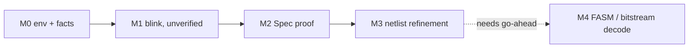

# Execution plan

Milestones follow `CLAUDE.md`, strictly in order. Each ends with its acceptance
check, a `jj` commit, and a stop for review. Board facts are in
`board/FACTS.md`.

## Open items to settle first

1. **XC7S6 vs XC7S50.** All vendor files are for the XC7S6. The footprint is
   documented as compatible, but each used pin (G11, E11) must be checked in
   the X-Ray `xc7s50ftgb196` package pin file (M0 step 4).
2. **PCB revision.** Is the Astria S7-50 the same PCB as this Leonidas
   schematic? Kirill to confirm if he knows; otherwise M1 is the test.
3. **Mode jumper JP1.** Open = JTAG-only boot, shorted = boot from flash.
   Either works for JTAG loading; knowing its state explains what the board
   does at power-up.

## M0: environment and facts

Install location: `~/opt/veryfpga/` (tools), `~/opt/veryfpga/chipdb/` (chip
database, generated once). Nothing system-wide.

1. **Read current docs before installing.** `FPGAwars/tools-openxc7` README
   and `install.sh`; note which openXC7 release and oss-cad-suite build it
   pulls, and whether it ships the nextpnr-xilinx Python chipdb scripts
   (`bbaexport.py`, `bbasm`) and the prjxray database.
2. **Install the toolchain** with that bundle. Fallbacks in order: openXC7
   `toolchain-installer`, openXC7 snap (snap needs root, so ask first), build
   nextpnr-xilinx from source.
   Tools to have on `PATH`: `yosys`, `nextpnr-xilinx`, `fasm2frames`,
   `xc7frames2bit`, `openFPGALoader`, `bbasm`.
3. **`env.sh`** at repo root: `PATH`, `PRJXRAY_DB_DIR`, `CHIPDB` location.
   **`TOOLS.md`**: exact version or commit of every tool and the database.
4. **Pin cross-check.** In the installed X-Ray database, confirm
   `spartan7/xc7s50ftgb196-1` exists and read its `package_pins.csv`: G11 must
   be bank 14 and clock-capable (MRCC), E11 bank 14. Record result in
   `board/FACTS.md`. Mismatch = stop and ask.
5. **JTAG access.** Plug J1, `lsusb` for the FTDI ID. Propose a udev rule for
   that ID (Kirill applies it). Then `openFPGALoader --detect` (try `-c ft232`
   if auto-detect fails). Expect it to report an XC7S50; check the
   IDCODE against openFPGALoader's part table.
   Record cable name in `board/FACTS.md`.
6. **Chip database.** Done: the openXC7 `2026-11-09` package ships a
   prebuilt per-die `chipdb-xc7s50.bin` covering `xc7s50ftgb196-1`; a trivial
   design placed, routed and produced a `.bit`. No generation needed.
7. **Lean.** Install `elan` (user installer). Look up the latest stable Lean 4
   release, create `lean/` with `lake new`, pin it in `lean-toolchain`, no
   Mathlib. `lake build` on the empty project.
8. **Accept:** `--detect` shows XC7S50; chipdb loads; `lake build` passes;
   `TOOLS.md` and `board/FACTS.md` complete. `jj commit`, stop.

## M1: blink it, unverified

1. `rtl/blinky.v`: 27-bit counter, `initial` value 0, no reset, `led =
   cnt[26]`. Ports: `clk`, `led`.
2. `board/astria.xdc`: `clk` on G11 and `led` on E11, both LVCMOS33. Clock
   period constraint 10 ns if nextpnr-xilinx accepts it.
3. `Makefile` taken from the openXC7 demo for this flow:
   `yosys synth_xilinx -flatten -arch xc7 -nosrl -nobram -nolutram -nodsp
   -nowidelut` (flag names checked against `help synth_xilinx`; the demo's
   `-abc9` dropped, it gives identical cells here) -> JSON -> `nextpnr-xilinx` -> FASM ->
   `fasm2frames` -> `xc7frames2bit` -> `build/blinky.bit`.
4. Check the netlist contains only `LUT*`, `INV`, `FDRE`, `CARRY4`, `IBUF`,
   `OBUF`, `BUFG` (`make check-cells`). Result: 27 FDRE, 7 CARRY4, 1 INV,
   IBUF, OBUF, BUFG; no LUTs. `INV` allowed by Kirill's decision.
5. **Show Kirill the pin assignments and wait for confirmation**, then
   `openFPGALoader -c ft232 build/blinky.bit` (SRAM load only, no flash).
6. **Accept:** LED0 blinks with about 1.34 s period. `jj commit`, stop.
   Done 2026-11-10: Kirill confirmed the blink.

## M2: Spec and its proof

1. `lean/VeryFPGA/Spec.lean`: `N := 27`, `step s = s + 1`, `init = 0`,
   `led s = s.msb`, `run n = step^[n] init`.
2. Lemma: `run n = BitVec.ofNat N n` (induction on `n`).
3. Theorem: `led (run n) = true <-> n % 2^N >= 2^(N-1)`. LED is active high,
   so this is also the pin level; state that in a comment.
4. Lemma names (`BitVec.msb`, `BitVec.ofNat_add`, `Nat.testBit`...) checked in
   the pinned toolchain before use.
5. **Accept:** clean `lake build`, no `sorry`, `#print axioms` shows only
   `propext`, `Classical.choice`, `Quot.sound` (or a subset). `jj commit`,
   stop.
   Done 2026-11-10: axioms `[propext, Quot.sound]`; `run` written as
   structural recursion rather than `Nat.iterate` (same meaning, simpler
   proofs).

## M3: lift the netlist, prove refinement

Done 2026-11-10. Files: `lean/VeryFPGA/{Prims,Netlist,Impl,Blinky,DefByEval,Refine}.lean`,
`test/{prims_tb.v,PrimsTest.lean,mutate.py,mutation.sh,Audit.lean}`.
`make verify` = bitstream + proof + primitive cross-check + mutation test,
writing `build/PROOF.txt` (hashes + axioms). Details and results in `TRUST.md`.

Deviations from the original plan:
- No LUTs in the netlist, so no LUT semantics and no LUT `INIT` mutation;
  replaced by a `CARRY4 CYINIT` mutation and an FDRE `INIT` mutation.
- The netlist is parsed at build time (`load_netlist`), not inside the
  kernel; `compile netlist` is evaluated at build time by `def_by_eval` and
  re-checked by the kernel.
- `bv_decide` adds a generated axiom (`step_ok._native.bv_decide.ax_1_27`)
  for its compiled certificate check; listed in `TRUST.md`.

## M4

Go-ahead given 2026-11-10. M4a (FASM) in four steps, each with its own
acceptance check and `jj` commit; M4b (bitstream) afterwards.

Decisions (Kirill, 2026-11-10):
- The M4a theorem is about the decoded FASM design against `Spec`
  directly, reusing the M3 proof structure. It does not go through the Yosys
  netlist.
- Clock network: structural check only. Every flop's CLK must be reached from
  the `clk` pad only through clock buffers and routing switches, each buffer
  in a known pass-through configuration. Clock quality stays an assumption.
- IO electrical features: allow-list of exactly the `board/astria.xdc`
  settings (LVCMOS33, 12 mA, slow slew, no pull); anything else rejected;
  listed in `TRUST.md` as electrical facts outside the theorem.

| Step | Content | Acceptance |
|---|---|---|
| M4a.1 | FASM parser; loader for the needed X-Ray files; every FASM line accounted for, unknown = hard error | all lines classified; each feature exists in the X-Ray database. **Done 2026-11-11**: 503/503 |
| M4a.2 | Physical wiring from enabled PIPs, tile wires and cross-tile connections | every used site input has exactly one driver; no enabled PIP unused. **Done 2026-11-11** |
| M4a.3 | Site semantics (SLICEL, IOB/IOI, clock tree) compiled to `Machine` with a LUT node; trusted, from UG474 and prjxray docs | decoded machine simulates like the netlist machine (sanity check). **Done 2026-11-11**: simulated against the spec directly (counts, random-state steps) |
| M4a.4 | Refinement proof of the decoded machine against `Spec`; mutation tests on FASM copies (LUT `INIT` bit, rerouted PIP) | theorem proved, mutants rejected. **Done 2026-11-11**: `phys_blinks`; LUT `INIT`, reroute and flop-init mutants rejected |

## Known risks

- **Chipdb generation** for FTGB196 is the least-trodden step; prebuilt
  databases cover other packages. If the bundle lacks the scripts, building
  nextpnr-xilinx from source adds an hour or more.
- **`bv_decide` on a deep embedding** may be slow or time out on a 27-bit
  carry chain expressed through generic netlist evaluation; the shallow
  fallback exists for this.
- **`bv_decide` trust**: it relies on Lean's compiled evaluation of the
  certificate checker (`Lean.ofReduceBool`), which will show in
  `#print axioms` and must be listed in `TRUST.md`.
